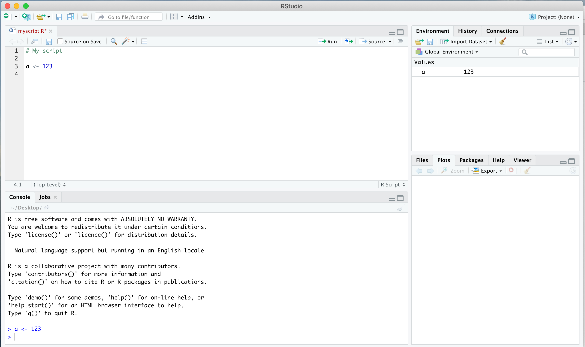
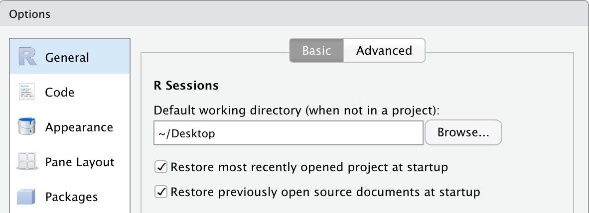

# TP 1 – Introduction à R


### Buts de ces travaux pratiques  

- Fonctionnement de RStudio
- Structure des données: variable, vecteur, data.frame
- Gestion des dossiers, lecture et sauvegarde de fichiers
- Remanier des données avec `dplyr`
- Visualiser des données avec `ggplot2`

### Accès à RStudio

**NB: pour ces TPs, nous recommandons fortement [RStudio en ligne](http://legcompute2.unine.ch:8787) au lieu d'une installation locale sur votre ordinateur!**

L'accès se fait uniquement par le Wifi `unine`.

## Travailler avec RStudio  

- Créez un nouveau fichier `R Script`. Utilisez toujours un tel fichier pour enregistrer votre code.



- Utilisez la touche `tab` pour auto-compléter du code, des liens, des options, etc.

- Sous le script, vous verrez la console pour interagir avec R. Vous pouvez aussi exécuter du code directement depuis le script : sélectionnez la/les lignes de code et appuyez sur `cmd` + `enter` (Mac) ou `ctrl` + `enter` (Windows/Linux).  


## Suggestion pour le troubleshooting: une liste à compléter!

- Décortiquez une commande complexe en ses éléments les plus simples
- Lisez toujours tous les messages d'erreur et apprenez petit à petit à reconnaître le type de problème. (e.g. "File not found" => faux nom ou emplacement?)

[Suggérez vos propres astuces aux autres svp]

## Travailler avec des variables, vecteurs et data.frames

Assigner des valeurs ou caractères à une variable

```
a <- 1
a

b <- "abc"
b

c <- TRUE
c
```

Faire des calculs simples

```
a <- 3
a + 1
a * 3

a^2

# fonctions simples
exp(a)
log(a)
sqrt(a)
sin(a)

b <- -4
abs(b)
```

Les vecteurs permettent d'enregistrer et de manipuler une série d'objets

```
vec <- c(1,2,3)
vec
vec * 5

vec <- 1:10
vec

vec <- seq(1,12,by=2)
vec

vec <- c(TRUE, FALSE, FALSE)
vec
vec == FALSE

vec <- c("lundi", "mardi", "mercredi")
vec
vec == "mardi"
```

On peut assigner des noms à des éléments d'un vecteur

```
working.hours <- c(8, 7, 10)
working.hours

names(working.hours) <- c("lundi", "mardi", "mercredi")
working.hours

working.hours["mardi"]
```

Échantillonnage des éléments d'un vecteur

```
weekdays <- c("lundi", "mardi", "mercredi")
sample(weekdays, 1)
sample(weekdays, 2)
```

Les data.frames pour stocker des tableaux

```
df <- data.frame(weekday = c("lundi", "mardi", "mercredi"),
					hours = c(8,7,10),
					breaks = c(1,3,4))
df
# les colonnes se comportent comme des vecteurs
df$weekday

df$hours
mean(df$hours)

# sélection de valeurs
df$hours[df$weekday == "lundi"]

df[df$weekday == "lundi",]

df[df$hours > 7,]
```

## Les boucles `for`

R permet de répéter des tâches à l'aide de boucles

```
## une boucle avec i prenant les valeurs de 1 à 5
for (i in 1:5) {

	print(i)

	}

## une boucle suivant un data.frame ligne par ligne


# la boucle fait autant de tours qu'il y a de lignes dans df
for (i in 1:nrow(df)) {

	# exemples d'opérations
	print(df[i,])

	print(df$breaks[i] * 60)

	# enregistrer des données dans la colonne "breaks.in.minutes"
	# on sélectionne la i-ième ligne
	df$breaks.in.minutes[i] <- df$breaks[i] * 60

	print(paste("fin de la boucle",i))
	}

# inspectez le résultat
df
```


## Le traitement de données avec `dplyr`  

Consultez aussi le [cheatsheet](./cheatsheets/dplyr-cheatsheet.pdf).

`dplyr` permet de manipuler et résumer des tableaux (data.frame) complexes y compris:
- sélectionner une partie des données
- résumer selon différents critères
- rajouter des nouvelles colonnes ou variables
- regrouper les données selon un facteur (e.g. population, etc.)
- combiner toutes ces opérations en une commande (pipe)

```
#install.packages("dplyr")

library(dplyr)

# exemple de données intégrées
head(iris)

# sélectionner des colonnes
iris %>% select(Sepal.Length, Sepal.Width, Species)

# regrouper par espèce
iris %>% group_by(Species)

# regrouper par espèce et résumer les données
iris %>% group_by(Species) %>% summarise(average = mean(Sepal.Length))

# régénérer un data.frame
iris.summary.df <- iris %>% group_by(Species) %>%
							summarise(average = mean(Sepal.Length)) %>%
							as.data.frame()
```

## Visualisation de données avec `ggplot2`

Consultez aussi le [cheatsheet](./cheatsheets/ggplot2-cheatsheet.pdf).

```
# install.packages("ggplot2")

library(ggplot2)

# utilisant les données mpg
head(mpg)
```

### Étape 1: définir le jeu de données

- définir le jeu de données mpg et les *aesthetics* avec `aes()`
- définir les axes x et y (choix de colonnes dans mpg)
- le graphe est vide (encore!)

`ggplot(mpg, aes(x = hwy, y = cty))`

### Étape 2: ajouter une géométrie (`geom_...`)

```
# geom_point() génère un scatter plot
ggplot(mpg, aes(x = hwy, y = cty)) + geom_point()
# shape, color et size peuvent être modifiés
ggplot(mpg, aes(x = hwy, y = cty)) + geom_point(shape = 20, size = 5, color = "red")

# échanger les données à visualiser
ggplot(mpg, aes(x = as.factor(year), y = cty)) + geom_boxplot()

# faire un boxplot (x doit être un facteur)
ggplot(mpg, aes(x = as.factor(cyl), y = hwy)) + geom_boxplot()
ggplot(mpg, aes(x = as.factor(manufacturer), y = hwy)) + geom_boxplot()

# faire un histogramme (on a seulement besoin de spécifier l'axe x)
ggplot(mpg, aes(x = hwy)) + geom_histogram()
ggplot(mpg, aes(x = hwy)) + geom_histogram(binwidth = 2)
```

### Jouer sur les paramètres et options

```
ggplot(mpg, aes(x = hwy, y = cty)) + geom_point(shape = 20, size = 5, color = "red", alpha = 0.2)
# les paramètres de geom_point() peuvent aussi représenter des données : définissez-les alors dans aes()
ggplot(mpg, aes(x = hwy, y = cty)) + geom_point(aes(size = cyl), alpha = 0.5)
ggplot(mpg, aes(x = hwy, y = cty)) + geom_point(aes(size = cyl, color = manufacturer), alpha = 0.5)


### changer la représentation des axes (e.g. limits, breaks, etc.)
ggplot(mpg, aes(x = hwy, y = cty)) + geom_point(aes(size = cyl, color = manufacturer), alpha = 0.5) +
  scale_x_continuous(limits = c(5,50), breaks = seq(5,50,5)) +
  scale_y_continuous(limits = c(5,100))

### changer les labels
ggplot(mpg, aes(x = hwy, y = cty)) + geom_point(aes(size = cyl, color = class), alpha = 0.5) + labs(x = "highway mileage", y = "city mileage")
# cherchez sur Google comment ajuster les labels de la légende !


### ajuster le theme(), faites une recherche google pour plus d'options
ggplot(mpg, aes(x = hwy, y = cty)) + geom_point(aes(size = cyl, color = manufacturer), alpha = 0.5) +
  labs(x = "highway mileage", y = "city mileage") +
  theme(axis.text = element_text(color = "black", size = 5))

```

### subdiviser un graphe selon un facteur

```
ggplot(mpg, aes(x = hwy, y = cty)) + geom_point(aes(size = cyl, color = manufacturer), alpha = 0.5) +
  labs(x = "highway mileage", y = "city mileage") +
  theme(axis.text = element_text(color = "black")) +
  facet_grid(. ~ manufacturer)
```

### enregistrer des graphes

```
ggsave("Plot.pdf")

# contrôler la mise en page en spécifiant les dimensions
ggsave("Plot.pdf", height = 6, width = 11)
```


## Lecture et enregistrement de fichiers  

La plupart des analyses `R` demandent l'importation de données. Les données proviennent :
- de vous-même (et vous décidez du format)
- d'un·e collaborateur·rice
- d'une banque de données en ligne

Les petits jeux de données sont souvent stockés sous format texte (.txt) ou Excel (.xlsx).

Les problèmes les plus fréquents lors du chargement d'un fichier sont:
- on ne comprend pas la structure des données
- on ne comprend pas le format (e.g. JSON, VCF, GFF, POPGEN, FASTA, etc.)

### Le dossier de travail (working directory)

R lit et enregistre les fichiers dans le dossier de travail, sauf si vous indiquez un chemin complet.

```
# afficher le dossier de travail actuel
getwd()

# définir un nouveau dossier de travail
setwd("/chemin/vers/votre/dossier")

# lister les fichiers du dossier de travail
list.files()
```

Dans RStudio, vous pouvez aussi passer par `Session` > `Set Working Directory` > `Choose Directory...`. Le dossier de travail par défaut se règle dans `Tools` > `Global Options` > `General`:



### Quelques termes techniques pour mieux gérer les erreurs lors de l'importation:  
- "Field delimiters" séparent les colonnes dans un fichier. Ceci peut être sous forme de tabulation, espace, virgule, etc.  
- "Special characters" (`\`, `"`, etc.)  
- "Text encoding" (UTF-8, etc.)  
- `class` et `colClasses`: la classe caractérise un type de données (e.g. `numeric`, `character`, `factor`). Une `colClass` définit le type de données dans une colonne.  
- `header`: la première ligne d'un fichier qui peut optionnellement spécifier le nom de la colonne ("weight", "number of observations", etc.)  

Si tout fonctionne correctement, vous ne recevrez aucun message d'erreur:

`data <- read.table("textfile.txt", header = T)`

[Attention: il faut que le fichier `textfile.txt` existe réellement dans le dossier spécifié]

Une erreur potentielle:

`data <- read.table("textfile.txt", header = T)`
`Error in scan(file = file, what = what, sep = sep, quote = quote, dec = dec, : line 1 did not have 3 elements`

Là, le problème est que le fichier ne contient pas un tableau "parfait" où chaque ligne contient le même nombre de données (ou colonnes). Il faut re-vérifier le fichier d'entrée ou spécifier correctement l'option `sep=`. Séparation par des espaces/tab/virgules? `sep=" "`, `sep="\t"`, `sep=","`?

Ajustez `header=T` ou `header=F`. Voir ci-dessus.

On peut sauter les premières lignes avec `skip = 2` (deux lignes)

Alternativement, on peut ignorer certaines colonnes: `colClasses = c("integer", "NULL", "character")` (après une colonne de chiffres, la deuxième colonne est ignorée, puis la troisième est lue comme des caractères)

### La lecture de fichiers Excel ou csv

**Attention**: définissez correctement le dossier de travail avec `setwd("/...")` (voir ci-dessus) ou spécifiez l'emplacement complet du fichier, e.g. `"/Users/dcroll/.../.../fichier.xlsx"`

```
# install.packages("openxlsx")
library("openxlsx")

# lire la première feuille dans le fichier Excel
df <- read.xlsx("fichier_excel.xlsx")
```

Alternativement, on peut exporter le fichier Excel sous format `.csv`  
`df <- read.csv("fichier_excel.csv", header = T)`

### Contrôler l'importation d'un fichier lu dans `R`

Il est très important de bien vérifier que le fichier est correctement importé.

```
data <- read.table("textfile.txt", header = T)
head(data)
```

Est-ce que les colonnes sont proprement identifiées? Sinon, on peut facilement renommer les colonnes:

`names(data) <- c("Location", "Population", "Number of individuals")`

Contrôler le format des données par colonne:

`str(data)`

On peut résoudre certains problèmes (caractères convertis en facteur)

`read.table(..., stringsAsFactors = F)`

Le format des données peut être changé sous certaines conditions

```
as.character(df$column1)
as.factor(df$column1)
as.numeric(df$column1)
```
Faites extrêmement attention quand vous essayez de convertir une colonne sous forme de `factor` en `character` ou `numeric`!

### Quelques exemples pour s'exercer

Vous trouverez dans le dossier [datasets](./datasets) une série d'exemples. Leur difficulté varie. Essayez de les importer directement ou de les modifier au préalable.


## Traiter des séquences d'ADN

Nous allons analyser des fichiers VCF représentant des génotypes de grandes populations plus tard. Ici, nous regardons l'exemple de traitement de séquences d'ADN au format `fasta`.

On utilisera le fichier [fasta de FOXP2](./fasta/FOXP2_nucl.aligned.fasta) (cf. cours 2 Génétique évolutive), qui se trouve dans le dossier `fasta` (le code ci-dessous le télécharge avec `wget`). Utilisez impérativement ce fichier et pas le fichier fourni lors du cours, car ce dernier ne contient pas de séquences alignées.

```
# obtenir le fichier
system("wget https://raw.githubusercontent.com/crolllab/teaching/master/TP_Génétique_évolutive/TP_1_Introduction_R/fasta/FOXP2_nucl.aligned.fasta")

# install.packages(c("pegas", "seqinr"))

# les packages les plus utiles
library(ape)
library(pegas)
library(seqinr)

# créer un objet DNAbin contenant les séquences fasta
FOXP2.DNAbin <- read.dna("FOXP2_nucl.aligned.fasta", format = "fasta")

# visualisation de l'alignement
image.DNAbin(FOXP2.DNAbin)

# évaluation de l'alignement, visualisation du polymorphisme
checkAlignment(FOXP2.DNAbin)

# faire un arbre phylogénétique simple
FOXP2.tree <- nj(dist(FOXP2.DNAbin))
plot(FOXP2.tree)

# changer l'enracinement
FOXP2.tree <- root(FOXP2.tree, outgroup = "Mus_musculus_var3")
plot(FOXP2.tree, main = "FOXP2 phylogeny")
```
