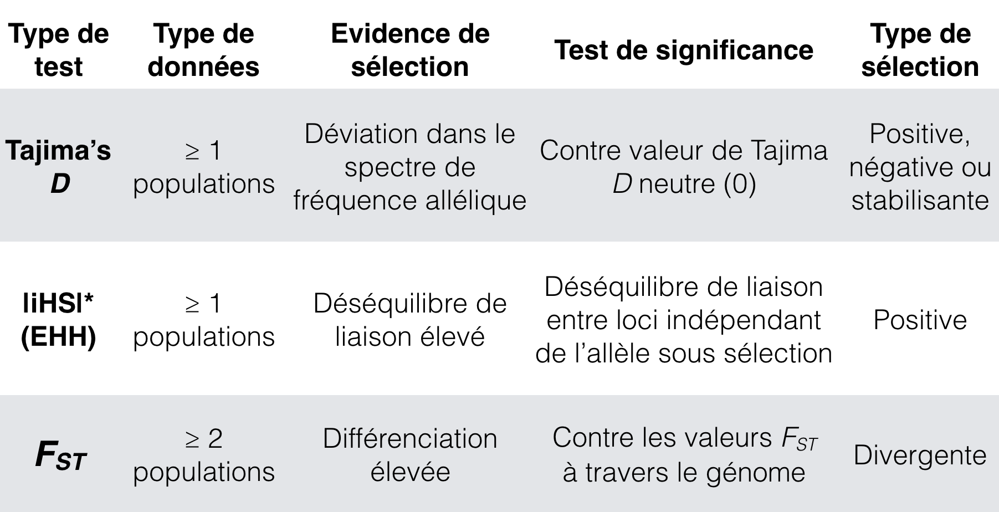
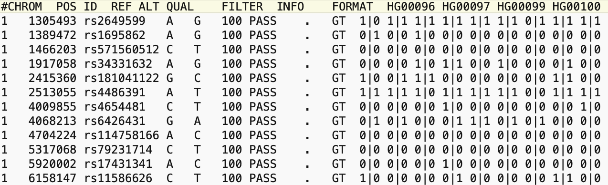
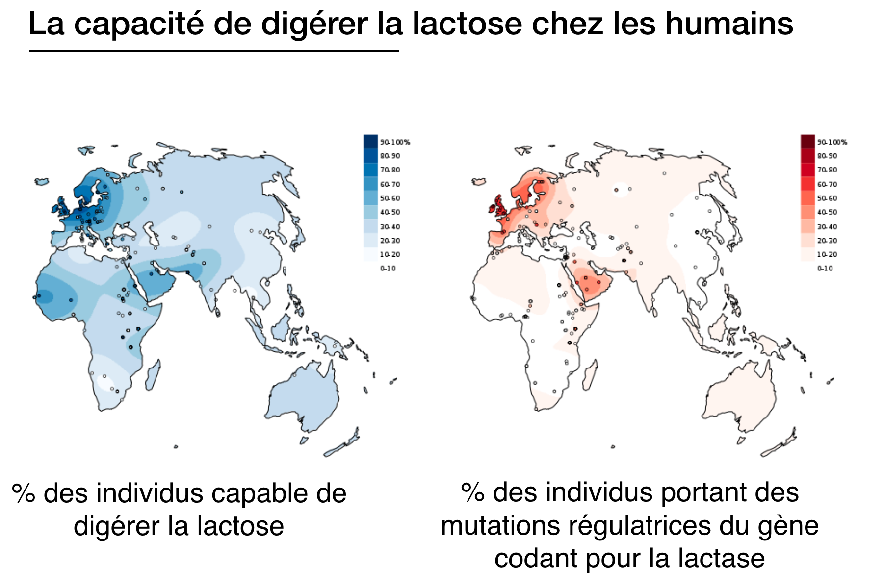
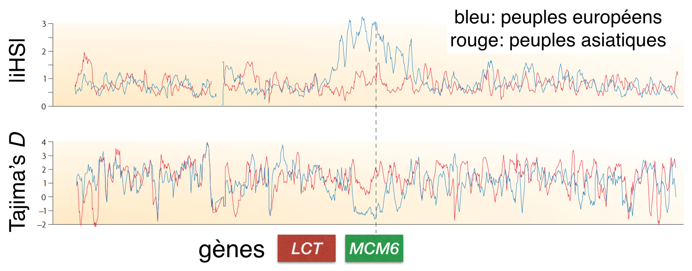

# TP 6 – Analyses de sélection dans les populations humaines


### Buts de ces travaux pratiques

- Comprendre les signatures principales de sélection au sein d'une espèce
- Réflexion sur la distinction entre les processus neutres et sélectifs

### Concepts importants

Référez-vous aux slides du cours "Génétique évolutive" si besoin.

- Techniques de séquençage, SNP
- Analyse en composantes principales (PCA), F<sub>ST</sub>
- Tajima's *D*
- Peuplement de la Terre par l'homme. Pour les intéressés: [Nielsen et al. 2017](https://www.nature.com/articles/nature21347)

### Les tests principaux de sélection

Seuls les tests applicables au sein d'une espèce sont présentés ici.



### Les données: "The 1000 Genomes Project"  
- La publication principale a été publiée dans Nature vol 526, pages 68–74, 2015: [https://www.nature.com/articles/nature15393](https://www.nature.com/articles/nature15393)
- 2504 individus de 26 populations à travers le monde
- 84,7 millions de SNP identifiés


### Les données simplifiées pour ces TP

- Facultatif: Explorez les données SNP mises à disposition dans votre navigateur web à l'adresse suivante: https://ftp.1000genomes.ebi.ac.uk/vol1/ftp/release/20130502/  


  

- Pour ces TPs, nous avons généré un sous-échantillonnage des SNPs (1 sur 2000) pour ne pas trop alourdir les analyses. Le fichier complet serait d'environ 1 TB. Le fichier préparé pour les TPs s'appelle `Human1000G.2000xSubsampled.MAF0.05.recode.vcf` (format VCF). Ce fichier est aussi filtré pour une fréquence allélique mineure (MAF) >0.05. Donc, les allèles rares n'y figurent plus!

- Les fichiers se trouvent dans ce dossier (le code ci-dessous les télécharge aussi avec `wget`). Pour les télécharger manuellement, cliquez sur le fichier correspondant puis sélectionnez "Raw" ou "Download". Enregistrez le fichier au bon endroit sur votre ordinateur.

- Attention: Assurez vous que votre ordinateur n'a pas modifié l'extension des fichiers (e.g. `.vcf` en `.vcf.txt`).


## La distribution des valeurs F<sub>ST</sub> à travers le génome humain

Jusque-là, nous nous sommes uniquement intéressés au F<sub>ST</sub> moyen à travers le génome. Cette valeur reflète la différenciation génétique moyenne entre populations.

Ici, nous allons étudier la distribution de ces valeurs à travers le génome. Une valeur F<sub>ST</sub> très élevée à un locus particulier indique une forte différenciation entre populations. Un tel locus pourrait alors coder pour un phénotype impliqué dans l'adaptation locale. Le raisonnement est que la sélection favoriserait localement un certain allèle. Les autres populations ne subiraient soit aucune sélection sur cet allèle, soit favoriseraient même l'allèle alternatif. Ces processus génèrent une différenciation des fréquences alléliques entre populations.

### Reprise du code du TP 4 pour charger un fichier VCF

Nous reprenons d'abord la fin des exercices du TP 4. Chargez le fichier VCF `Human1000G.2000xSubsampled.MAF0.05.recode.vcf` du génome intégral. Puis, assignez les individus aux populations.

(Revenez au TP 4 si le code ci-dessous ne paraît pas assez clair.)

```
# à ajuster si besoin!
# setwd("/home/ge-daniel/some_folder")

# obtenir les fichiers
system("wget https://raw.githubusercontent.com/crolllab/teaching/master/TP_Génétique_évolutive/TP_6_Selection_pop_humaines/Human1000G.2000xSubsampled.MAF0.05.recode.vcf")
system("wget https://raw.githubusercontent.com/crolllab/teaching/master/TP_Génétique_évolutive/TP_6_Selection_pop_humaines/Human1000G.MCM6.vcf")
system("wget https://raw.githubusercontent.com/crolllab/teaching/master/TP_Génétique_évolutive/TP_6_Selection_pop_humaines/Human1000G.info.txt")

# chargez les packages
library(vcfR)
library(adegenet)
library(ggplot2)
library(hierfstat)
library(gplots)
library(RColorBrewer)
library(pegas)
library(reshape2)


# lire le fichier VCF & conversion en format genind
vcf <- read.vcfR("Human1000G.2000xSubsampled.MAF0.05.recode.vcf")
allchr.snps.genind <- vcfR2genind(vcf)
allchr.snps <- vcfR2genlight(vcf)

# à partir de ces informations, créer un data.frame
allchr.df <- data.frame(position = allchr.snps@position, chromosome = allchr.snps@chromosome, SNPid = allchr.snps@loc.names)
# générer l'ordre correct des chromosomes
allchr.df$chromosome <- factor(allchr.df$chromosome, levels = c(1:22, "X"))

# lire le fichier résumant l'information sur les populations
info.df <- read.table("Human1000G.info.txt", header=T, sep="\t")

# voir les catégories
head(info.df)

# assignez les individus aux populations ("Population.name")
pop(allchr.snps) <- info.df$Population.name[match(indNames(allchr.snps.genind), info.df$Sample.name)]
pop(allchr.snps.genind) <- info.df$Population.name[match(indNames(allchr.snps.genind), info.df$Sample.name)]
```

### Calculs des valeurs F<sub>ST</sub> et autres statistiques

```
# Calculs d'un grand nombre de statistiques par populations et loci (y compris les Fst). Étape lente (1-3 min).
pop.stats <- basic.stats(allchr.snps.genind)

### Inspectez les composantes de pop.stats (voir TP 5)

# Les fréquences alléliques à un locus spécifique (e.g. le SNP rs6537484)
pop.stats$pop.freq$rs6537484
```

### Exploration de la diversité génétique à travers les populations humaines

```
# création d'un data.frame résumant Fis et Hs, puis l'information sur les populations
pop.stats.df <- data.frame(Fis = colMeans(pop.stats$Fis, na.rm = T), Hs = colMeans(pop.stats$Hs, na.rm = T), Population.name = names(colMeans(pop.stats$Fis, na.rm = T)))
head(pop.stats.df)

# création d'une colonne résumant les régions
pop.stats.df$Superpopulation.name <- info.df$Superpopulation.name[match(pop.stats.df$Population.name, info.df$Population.name)]

# inspection du contenu
head(pop.stats.df)

# visualisation du Fis à travers les populations
ggplot(pop.stats.df, aes(y = Fis, x = reorder(Population.name, Fis), fill = Superpopulation.name)) +
  geom_bar(stat = "identity") + labs(x = "Populations") +
  theme(axis.text.x = element_text(angle = 45, hjust = 1))

ggsave("Fis_populations.pdf", width = 8, height = 7)
```

Q1: Quelles sont les causes probables d'un F<sub>IS</sub> élevé dans certaines populations humaines?

Q2 (optionnelle): Est-ce que le niveau de consanguinité d'une population a un impact sur l'efficacité avec laquelle la sélection fixe un allèle avantageux? Expliquez pourquoi oui ou non.

Q3: Visualisez la distribution des valeurs F<sub>ST</sub> à travers tous les loci à l'aide d'un histogramme. Rajoutez une ligne verticale pour la valeur F<sub>ST</sub> moyenne. Astuce: `+ geom_vline(xintercept = ...)`

### Création d'un data.frame comprenant les positions chromosomales et statistiques par locus (Hs, Fst, etc.)

```
stats.df <- pop.stats$perloc
stats.df$SNPid <- row.names(stats.df)
# allchr.df a été créé précédemment
stats.allchr.df <- merge(allchr.df, stats.df)

head(stats.allchr.df)
```

### Visualisation des valeurs F<sub>ST</sub> le long des chromosomes

```
ggplot(stats.allchr.df[stats.allchr.df$chromosome %in% 1:5,], aes(x=position/1000000, y=Fst)) +
  geom_point() + geom_smooth(linewidth = 1, span = 0.05) +
  coord_cartesian(ylim=c(0, 0.6)) +
  labs(x = "Position in Mb", y = "FST per locus") +
  facet_grid(chromosome ~ .)
ggsave("Fst.per-locus.pdf", width = 12, height = 8)
```
Visualisez la distribution des valeurs F<sub>ST</sub> le long des chromosomes 1-5.

Q4: Identifiez à l'oeil une région potentiellement sous sélection divergente (= F<sub>ST</sub> élevé).


### Visualisation des fréquences alléliques à des loci avec un F<sub>ST</sub> extrême

Nous allons investiguer la distribution des fréquences alléliques par population. Vu que nous nous intéressons à des loci avec un F<sub>ST</sub> extrême, nous nous attendons à de fortes différences au niveau des fréquences alléliques.

```
# visualisez les SNPs avec les Fst les plus extrêmes (tri du data.frame)
head(stats.allchr.df[order(-stats.allchr.df$Fst),])

# fréquences alléliques à travers les populations d'un SNP en particulier: e.g. rs10270859
locus <- "rs10270859"

SNP.freq.table <- as.data.frame(pop.stats$pop.freq[locus])
names(SNP.freq.table) <- unique(pop(allchr.snps.genind))

# conversion en tableau "melted"
RefSNP.freq.table <- melt(SNP.freq.table[1,], variable.name = "population", value.name = "ref_allele_frequency")

# Aperçu du tableau créé
RefSNP.freq.table


# rajoutez l'information sur les régions
RefSNP.freq.table$region <- info.df$Superpopulation.name[match(RefSNP.freq.table$population, info.df$Population.name)]

# visualisation des fréquences
ggplot(RefSNP.freq.table, aes(x = reorder(population, ref_allele_frequency), y = ref_allele_frequency, fill = region)) +
  geom_bar(stat = "identity") +
  labs(x = "Population", y = "Reference allele frequency") +
  ggtitle(paste(locus)) +
  theme(axis.text = element_text(colour = "black"), axis.text.x = element_text(angle = 45, hjust = 1))

ggsave(paste0("Allele_freq-",locus,".pdf"), width = 7, height = 4.5)
```

Q5: Décrivez le pattern des fréquences alléliques à travers les populations. Est-ce que vous pouvez expliquer le pattern par un processus neutre? Alternativement, quel scénario de sélection aurait pu générer ce pattern?

Q6 (optionnelle): Explorez la région comprenant le SNP rs10270859 à l'aide du site [Ensembl](http://www.ensembl.org/Homo_sapiens/Info/Index). Quel est l'allèle ancestral (partagé avec d'autres primates)? Dans quelle région au monde est l'allèle ancestral le plus fréquent? Est-ce que ceci correspond à votre prédiction?

Q7 (optionnelle): Dans quel gène se trouve le SNP rs10270859? Trouvez l'information à l'aide d'[Ensembl](http://www.ensembl.org/Homo_sapiens/Info/Index). Quelle est la fonction prédite de ce gène?

Q8: Choisissez trois autres SNP parmi les 10 avec un F<sub>ST</sub> extrême et visualisez les fréquences alléliques. Est-ce qu'il y a un pattern partagé à travers ces loci?


## Analyse du Tajima's *D* au locus codant pour la lactase

Revue traitant le sujet de la sélection récente chez l'homme: https://www.nature.com/articles/nrg2187

Référez-vous au cours de génétique évolutive pour plus d'information sur l'histoire du locus codant pour la lactase.





Le jeu de SNP utilisé jusque là (`Human1000G.2000xSubsampled.MAF0.05.recode.vcf`) ne comprenait pas les loci avec allèles rares (fréquence d'allèle mineur < 5%). Vu que l'analyse du Tajima's *D* est basée sur le spectre des fréquences alléliques, y compris les variants rares, ce jeu de SNP n'est donc pas approprié.

Nous allons donc utiliser le jeu de données suivant:
- Fichier VCF `Human1000G.MCM6.vcf` comprenant uniquement la région du gène *MCM6*: chromosome 2, positions 136'597'196-136'633'996 bp. Ces positions se réfèrent au génome de référence GRCh37 (hg19), utilisé par le 1000 Genomes Project.

Visualisation sur [Ensembl GRCh37](https://grch37.ensembl.org/Homo_sapiens/Gene/Summary?db=core;g=ENSG00000076003;r=2:136597196-136633996). NB: le site principal d'Ensembl utilise la version plus récente du génome de référence (GRCh38), où les positions sont différentes (*MCM6*: 135'839'626-135'876'426 bp).

La région du gène *MCM6* comprend les mutations qui régulent l'expression du gène *LCT* (lactase). Pour identifier une signature de sélection sur l'expression du gène LCT, il faut donc analyser la région du gène *MCM6* plutôt que *LCT* lui-même. La mutation la plus connue associée à la persistance de la lactase en Europe (-13910 C>T, rs4988235) se trouve à la position 136'608'646 bp (GRCh37).

Q9 (optionnelle): Quelle est grossièrement la distance physique entre les exons les plus proches de *LCT* et *MCM6*?

Q10 (optionnelle): Quelles signatures de sélection correspondent à un Tajima's *D* positif et négatif?

### Préparation des données de la région *MCM6*
```
# lire le fichier MCM6 (le locus de la lactase)
vcf <- read.vcfR("Human1000G.MCM6.vcf")
MCM6.DNAbin <- vcfR2DNAbin(vcf)

# lire le fichier résumant l'information sur les populations
info.df <- read.table("Human1000G.info.txt", header=T, sep="\t")

# voir les catégories
head(info.df)

# création d'un data.frame avec les colonnes populations, région et Tajima's D
taj.df <- data.frame(pop=unique(info.df$Population.name), tajima=NA)
taj.df$region <- info.df$Superpopulation.name[match(taj.df$pop, info.df$Population.name)]
```

### Visualisation du spectre de fréquences alléliques

```
# sélection de la population à étudier (essayez d'autres selon votre choix)
pop <- "CEPH"

selected.samples <- info.df$Sample.name[info.df$Population.name == pop]
MCM6.subset <- MCM6.DNAbin[grepl(paste(selected.samples,collapse = "|"), labels(MCM6.DNAbin)),]

# identifiez les positions des SNP effectivement variables au sein de la population
seg.sites(MCM6.subset)

# visualisation de l'alignement des SNP variables et invariants au sein d'une population donnée
pdf("MCM6_alignment_view.pdf", width=10, height=8)
image.DNAbin(MCM6.subset, show.labels = F, xlab = "Number of SNPs in MCM6", ylab = "Individuals in population")
dev.off()

# analyse de la fréquence allélique à chaque position
freq.spectrum <- site.spectrum(MCM6.subset)
# nombre de séquences (2 haplotypes par individu)
n.ind <- nrow(MCM6.subset)

# visualisation du spectre de fréquences alléliques
ggplot(data.frame(freq = freq.spectrum[freq.spectrum > 0] / n.ind), aes(x = freq)) +
  geom_histogram(binwidth = 0.05) +
  labs(x = "Allele frequency", y = "Number of SNPs") +
  ggtitle(paste(pop))
ggsave(paste0("MCM6_frequency_spectrum_",pop,".pdf"), width=4, height=3)
```


### Visualisation du Tajima's *D* par population: région du *MCM6*

```
# le principe de la fonction tajima.test
tajima.test(MCM6.subset)

# voici une boucle qui calcule le Tajima's D par population
for (pop in unique(info.df$Population.name)) {
  selected.samples <- info.df$Sample.name[info.df$Population.name == pop]
  MCM6.subset <- MCM6.DNAbin[grepl(paste(selected.samples,collapse = "|"), labels(MCM6.DNAbin)),]
  if (dim(MCM6.subset)[1] > 0) {
    taj.df$tajima[taj.df$pop == pop] <- tajima.test(MCM6.subset)$D
    }
}

taj.df <- taj.df[!is.na(taj.df$tajima),]

# les valeurs sont affichées au bout de chaque barre
ggplot(taj.df, aes(x=reorder(pop, tajima), y=tajima, fill=region)) +
  geom_bar(stat = "identity") +
  geom_hline(yintercept = 0) +
  geom_text(aes(label = sprintf("%.2f", tajima), hjust = ifelse(tajima >= 0, -0.15, 1.15)), angle = 90, size = 2.5) +
  scale_y_continuous(expand = expansion(mult = 0.15)) +
  labs(x="Populations", y="Tajima's D") +
  theme(axis.text.x = element_text(angle = 60, hjust = 1), axis.text = element_text(color = "black"))

ggsave("TajimaD.lactase.pdf", width = 6, height = 4)
```

Q11: Faites l'analyse des Tajima's *D*. Discutez les indices d'une sélection pour la capacité à digérer le lactose à travers le monde. Est-ce que les régions avec un fort signal de sélection correspondent avec l'émergence de l'agriculture laitière?


## Les variants causaux de la persistance de la lactase

La persistance de la lactase n'est pas due à une seule mutation. Au moins cinq variants dans la région régulatrice située ~14 kb en amont du gène *LCT* (dans un intron de *MCM6*) sont associés à la persistance de la lactase et augmentent l'activité du promoteur de *LCT* en expériences fonctionnelles ([Liebert et al. 2017](https://doi.org/10.1007/s00439-017-1847-y)). Ces variants sont apparus indépendamment dans différentes populations, un exemple d'évolution convergente:

| Variant | Population d'origine | Référence |
|---|---|---|
| -13910\*T (rs4988235) | Europe | [Enattah et al. 2002](https://doi.org/10.1038/ng826), [Olds & Sibley 2003](https://doi.org/10.1093/hmg/ddg244) |
| -13915\*G (rs41380347) | Péninsule arabique | [Imtiaz et al. 2007](https://doi.org/10.1136/jmg.2007.051631), [Enattah et al. 2008](https://doi.org/10.1016/j.ajhg.2007.09.012) |
| -14010\*C (rs145946881) | Afrique de l'Est | [Tishkoff et al. 2007](https://doi.org/10.1038/ng1946), [Jensen et al. 2011](https://doi.org/10.1007/s00439-011-0966-0) |
| -13907\*G (rs41525747) | Afrique de l'Est | [Tishkoff et al. 2007](https://doi.org/10.1038/ng1946) |
| -14009\*G (rs869051967) | Afrique de l'Est (Éthiopie) | [Jones et al. 2013](https://doi.org/10.1016/j.ajhg.2013.07.008) |

Seuls les trois premiers variants sont présents dans `Human1000G.MCM6.vcf`. Les positions des variants (-13910, etc.) sont comptées à partir du début du gène *LCT*, qui se trouve sur le brin négatif. Dans le fichier VCF (brin positif), les allèles apparaissent donc sous forme complémentaire: -13910 C>T est noté G>A.

Le code ci-dessous calcule la fréquence de l'allèle causal de chaque variant dans chaque population. Nous réutilisons les objets `vcf` et `info.df` de la préparation des données de la région *MCM6* (voir ci-dessus).

```
# variants causaux de la persistance de la lactase présents dans Human1000G.MCM6.vcf (positions GRCh37)
causal.df <- data.frame(variant = c("-13910*T (rs4988235)", "-13915*G (rs41380347)", "-14010*C (rs145946881)"),
                        origin = c("Europe", "Péninsule arabique", "Afrique de l'Est"),
                        POS = c(136608646, 136608651, 136608746))

# vérifiez les allèles REF et ALT: l'allèle causal est toujours l'allèle ALT
getFIX(vcf)[getPOS(vcf) %in% causal.df$POS, c("POS", "REF", "ALT")]

# génotypes des trois variants (format "0|1"), une ligne par variant et une colonne par individu
causal.gt <- extract.gt(vcf, element = "GT")[match(causal.df$POS, getPOS(vcf)), ]

# nombre de copies de l'allèle causal (codé par 1) par individu: 0, 1 ou 2
causal.count <- matrix(nchar(gsub("[^1]", "", causal.gt)), nrow = nrow(causal.gt), dimnames = dimnames(causal.gt))

# population de chaque individu
sample.pop <- info.df$Population.name[match(colnames(causal.count), info.df$Sample.name)]

# fréquence de l'allèle causal par population (2 allèles par individu)
freq.df <- data.frame()
for (i in 1:nrow(causal.df)) {
  freq <- tapply(causal.count[i,], sample.pop, sum) / (2 * table(sample.pop))
  freq.df <- rbind(freq.df, data.frame(variant = causal.df$variant[i], pop = names(freq), freq = as.numeric(freq)))
}
freq.df$region <- info.df$Superpopulation.name[match(freq.df$pop, info.df$Population.name)]

# regrouper les populations par région
pop.order <- unique(info.df$Population.name[order(info.df$Superpopulation.name, info.df$Population.name)])
freq.df$pop <- factor(freq.df$pop, levels = pop.order)
freq.df$variant <- factor(freq.df$variant, levels = causal.df$variant)

# attention: chaque variant a sa propre échelle (scales = "free_y")
ggplot(freq.df, aes(x = pop, y = freq, fill = region)) +
  geom_col() +
  geom_text(aes(label = ifelse(freq > 0, sprintf("%.3f", freq), "")), angle = 90, hjust = -0.15, size = 2.5) +
  facet_wrap(~ variant, ncol = 1, scales = "free_y") +
  scale_y_continuous(expand = expansion(mult = c(0, 0.35))) +
  labs(x = "Populations", y = "Frequency of the causal allele") +
  theme(axis.text.x = element_text(angle = 60, hjust = 1), axis.text = element_text(color = "black"))

ggsave("LP_causal_alleles.pdf", width = 9, height = 7)
```

Q12: Décrivez la distribution de chaque allèle causal à travers les populations. Est-ce que la fréquence de -13910\*T en Europe et en Asie du Sud correspond à vos attentes? Comment expliquez-vous la présence de -13910\*T dans les populations américaines et afro-américaines, et celle de -13915\*G à Porto Rico?

Q13: Qu'est-ce que la spécificité des allèles causaux par population nous apprend sur l'origine de la persistance de la lactase? Pourquoi le 1000 Genomes Project sous-estime-t-il probablement l'importance des allèles -13915\*G, -14010\*C, -13907\*G et -14009\*G? Astuce: regardez quelles populations sont échantillonnées.
